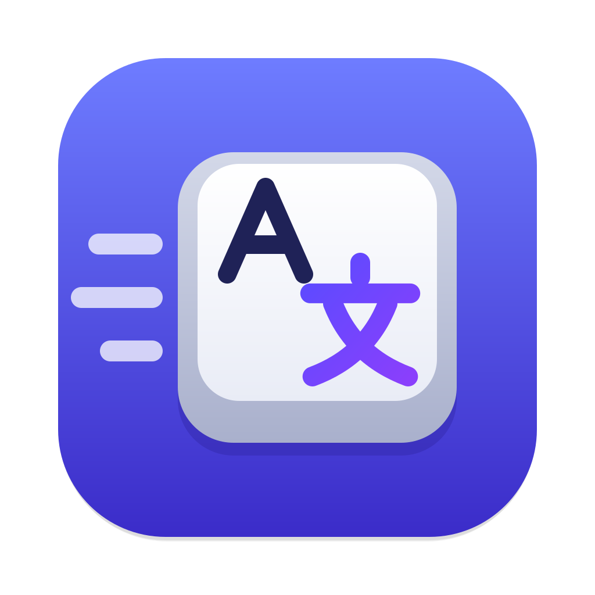
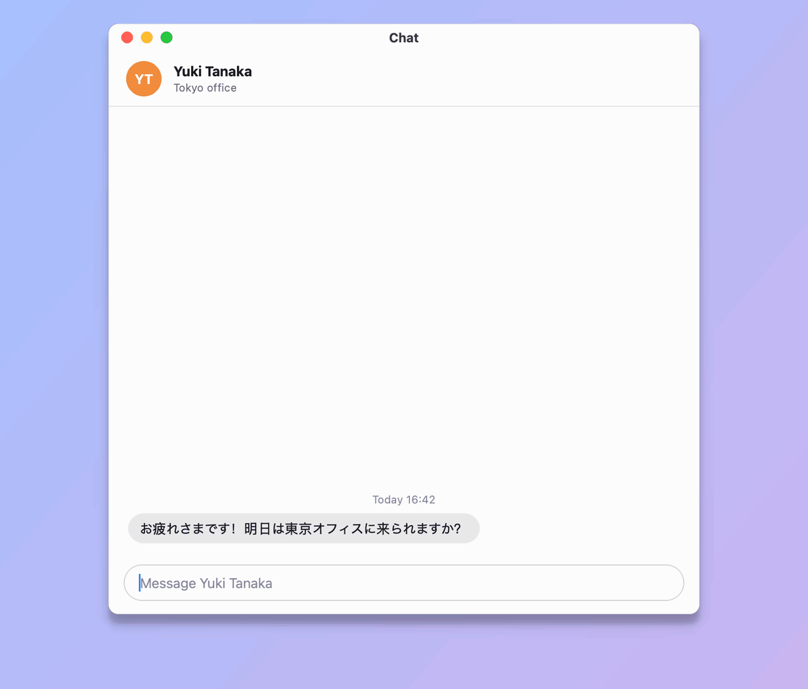
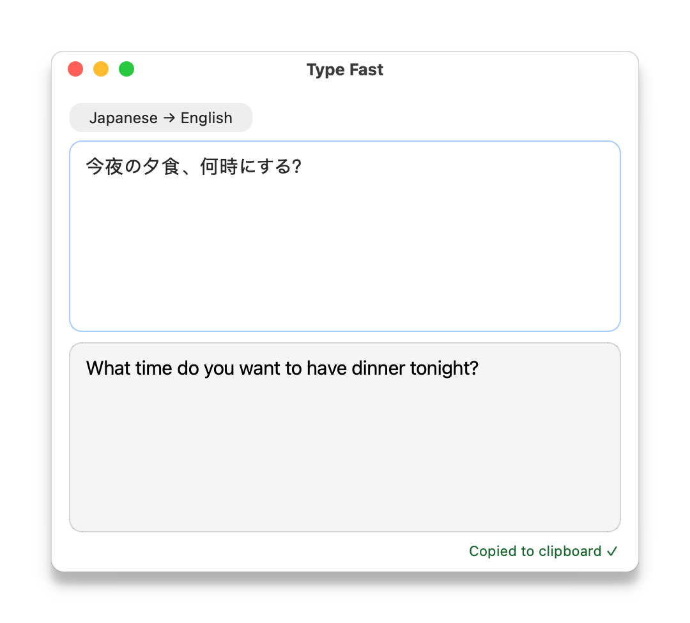
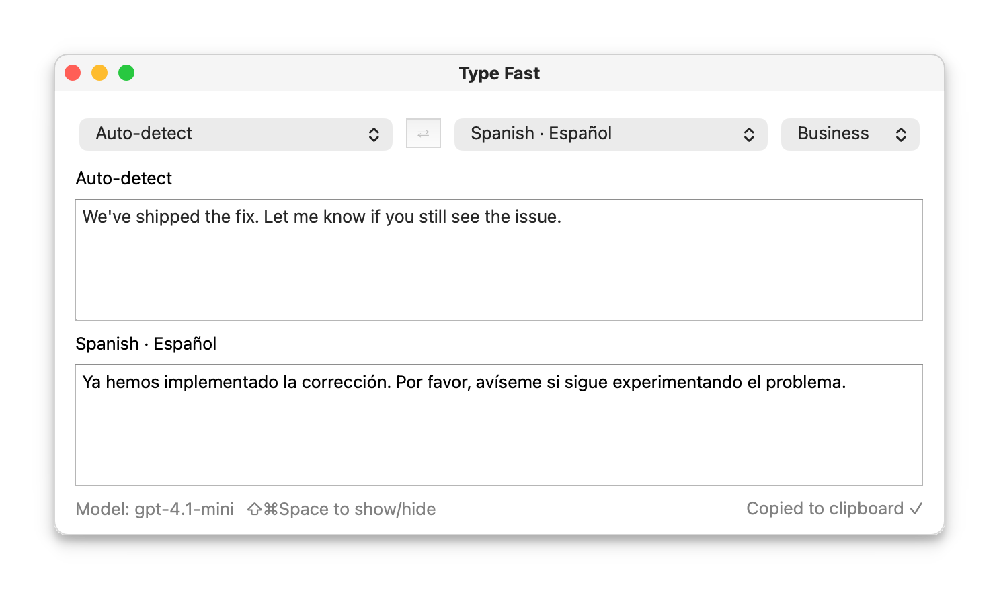

# Type Fast

**Type in one language. Get it in another — as you type.**

A tiny macOS and Windows translator that pops up with a hotkey, streams translations from
OpenAI or Azure AI Foundry, and copies the result for you.

<picture>
  <source media="(prefers-reduced-motion: reduce)" srcset="docs/images/demo.png">
  
</picture>

Press <b>⇧⌘Space</b> (macOS) / <b>Ctrl+Shift+Space</b> (Windows) in any app, type, and press it again to paste the translation.

## Features

- ⚡ **Live translation** — the translation streams in as you type; as you keep
  typing, finished lines aren't re-translated.
- ⌨️ **Spotlight-style hotkey** — press **⇧⌘Space** in any app to pop up a
  minimal window (**Ctrl+Shift+Space** on Windows); press it again or **Esc** to go back.
- 🪟 **Stays out of your way** — the window is slightly see-through and fades
  further while you work in another app.
- 📋 **Auto-paste** — press the hotkey again and the finished translation is
  pasted into your app. It is on your clipboard too.
- 🌍 **16 languages + auto-detect** — English, Japanese, Chinese, Korean,
  Spanish, French, German, and [more](docs/usage.md#languages).
- ✨ **No translation mode** — pick **Same as input** to keep your text in its
  own language and just [clean it up and polish it](docs/usage.md#no-translation).
- 🎩 **Tone control** — Polite, Casual, Formal, Business, Friendly, Neutral,
  Tech (keeps technical terms as practitioners write them), your own custom
  instruction, or **Auto**, which picks the tone that fits what you wrote.
- 🎙️ **Voice input** — press **⇧⌘M** / **Ctrl+Shift+M** in any app, speak, and press it again:
  your speech is transcribed, cleaned of "um"s and false starts, translated,
  and pasted into your app. Or click the mic in the window to dictate there.
- 🔌 **OpenAI or Azure AI Foundry** — bring your own key, switch providers in Settings, and pick an OpenAI model or your own Foundry deployment.

## Screenshots

<table>
  <tr>
    <td align="center" width="50%">
      
       <b>Summon anywhere</b> — a minimal popup with ⇧⌘Space / Ctrl+Shift+Space
    </td>
    <td align="center" width="50%">
      
       <b>Pick a language and tone</b> — or let it auto-detect
    </td>
  </tr>
</table>

## Install

### macOS

1. Download `Type-Fast-macos-arm64.zip` from the
   [latest release](https://github.com/wangx173/type-fast/releases/latest),
   unzip it, and drag **Type Fast.app** into `/Applications`. The prebuilt app
   requires an Apple Silicon Mac; on Intel Macs,
   [run from source](docs/development.md#run-from-source).
2. The app is ad-hoc signed, not notarized, so macOS blocks the first launch:
   - **macOS 15 and later:** open the app once, then go to **System Settings →
     Privacy & Security** and click **Open Anyway**.
   - **macOS 14 and earlier:** right-click the app → **Open** → **Open**.
3. Set your OpenAI API key in **Settings → OpenAI → Set API Key…** (⌘,).

### Windows

1. Download `Type-Fast-windows-x64.zip` from the
   [latest release](https://github.com/wangx173/type-fast/releases/latest).
   The prebuilt app supports Windows 10/11 x64, not Windows on Arm.
2. Unzip it anywhere and open **Type Fast.exe** inside the **Type Fast**
   folder. Keep the entire folder together, including `_internal`; no Python
   installation is needed.
3. The build is unsigned. If SmartScreen warns you about this trusted release,
   choose **More info → Run anyway**. If your organization blocks unsigned apps,
   ask your administrator rather than bypassing its policy.
4. Right-click the Type Fast tray icon, then choose
   **Settings → OpenAI → Set API Key…** (**Ctrl+,** while the window has focus).

### Choose a provider

To use Azure AI Foundry instead, choose **Settings → Azure AI Foundry → Set Endpoint, Key & Deployment…**,
or follow the [Foundry setup guide](docs/foundry-setup.md), or let
[a setup script](docs/foundry-setup.md#set-up-with-a-script) do it for you.
Switch between them in **Settings → Provider**; the bottom of the window shows
which one is in use.

To run from source, see [Development](docs/development.md).

## Usage

Press **⇧⌘Space** / **Ctrl+Shift+Space** in any app and type in the top box. The translation appears
below shortly after you pause, or right away when you end a sentence or press
Return. When it finishes, it is copied to the clipboard. Press the same hotkey to
go back to your app and paste it there (if the translation is still coming in,
it is pasted as soon as it finishes, provided that takes under 5 seconds and
you don't click or type first), or **Esc** to go back without pasting.
On macOS, Type Fast first asks you to allow it in **Accessibility** settings
so it can paste. Windows needs no permission, but cannot auto-paste into apps
running as administrator; see [Auto-paste](docs/usage.md#auto-paste).

| macOS shortcut | Windows shortcut | Action |
|----------------|------------------|--------|
| **⇧⌘Space** | **Ctrl+Shift+Space** | Show Type Fast, or hide it and paste |
| **Esc** | **Esc** | Hide the window without pasting |
| **⌘L** | **Ctrl+L** | Show the language and tone pickers |
| **⇧⌘M** | **Ctrl+Shift+M** | Show Type Fast and start voice input; press again to stop, hide, and paste |
| **⌘,** | **Ctrl+,** | Set your OpenAI API key |

The **Settings** menu also lets you change the model (OpenAI) or deployment
(Azure AI Foundry), the hotkey, the window
transparency, the custom tone, and voice input, and turn auto-paste off. See the [usage guide](docs/usage.md) for
details.

## Documentation

| Guide                                    | What's inside                                            |
|------------------------------------------|----------------------------------------------------------|
| [Usage](docs/usage.md)                   | Window layouts, hotkey, auto-paste, languages, tone, and voice input |
| [Configuration](docs/configuration.md)   | API keys, Azure AI Foundry, models, and saved settings   |
| [Foundry setup](docs/foundry-setup.md)   | Create a Foundry resource, deploy a model, and connect   |
| [Development](docs/development.md)       | Run from source, test, build the macOS bundle or Windows folder, file issues/PRs |

## Roadmap

- Store the API key in the macOS Keychain instead of a key file.
- Sign and notarize the app with a Developer ID.
- A menu-bar wrapper (and hiding the Dock icon).

## License

[MIT](LICENSE) © Xiang Wang
